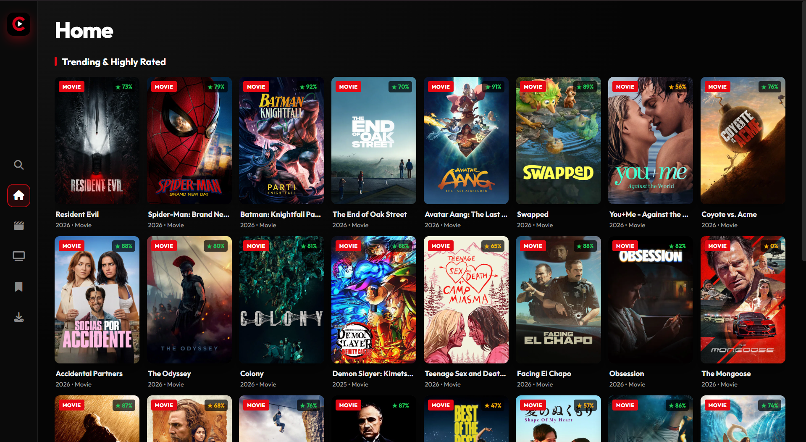

# 🎬 Cinebroad

A modern, lightweight desktop application for searching, streaming, and downloading movies directly to your PC.

## 📝 Project Overview

**Cinebroad** is a cross-platform desktop application built with **Electron.js** and **Node.js**.  
It provides a streamlined “Search & Download” experience by aggregating movie results from multiple public torrent providers and enabling direct downloads without requiring any external torrent client.

Designed with a clean, Netflix-inspired dark interface, the application eliminates the need to browse ad-heavy torrent sites by offering an ad-free, safe, and responsive desktop environment.

---

## ✨ Key Features

### 🚀 Integrated Search Engine  
Scrapes multiple public providers (**1337x**, **YTS**, **PirateBay**) simultaneously to deliver high-quality movie results.

### 🔽 Smart Download Manager  
Displays all ongoing downloads with real-time updates on:
- Download speed  
- Peer count  
- Total progress  

### ⏯️ Full Control  
Built-in controls allow users to:
- Pause  
- Resume  
- Cancel  
any download instantly.

### 📂 Custom Storage  
Users can dynamically choose the download directory on their system.\

### 🔍 Advanced Filtering  
Search results can be filtered by:
- Quality (4K, 1080p, 720p)  
- File size  
- Seed count  
Includes **pagination** with "Load More" support to browse large result sets.

### 🛡️ Error Handling  
Automatically detects:
- Network failures  
- Provider blocks  
- ISP restrictions  
and displays user-friendly error messages.

---

## 🛠️ Tech Stack

**Frontend:**  
- HTML5  
- CSS3  
- JavaScript (Renderer Process)

**Backend:**  
- Node.js  
- Electron (Main Process)

**Core Libraries:**  
- `webtorrent` (P2P torrent handling)  
- `torrent-search-api` (Magnet link scraping)  
- `electron-builder` (Installer generation)

---

## ⚠️ Disclaimer

This project is intended **for educational purposes only**, demonstrating how Electron.js and WebTorrent can be used to create desktop applications.

The developer does **not** encourage or support the downloading of copyrighted content.  
Users are responsible for complying with local laws.  
If torrenting is restricted in your region, you should use a VPN.

